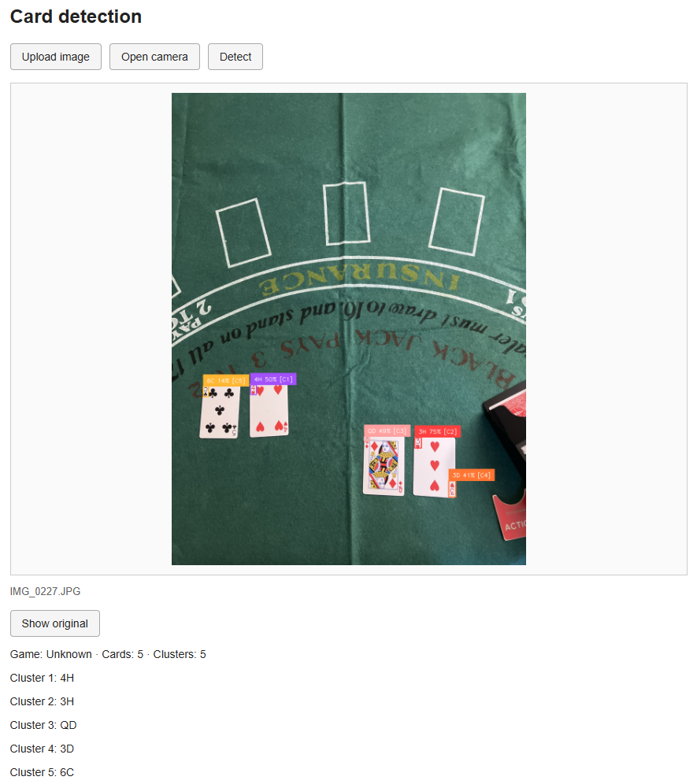

# Playing Card Detection and Game Classification

## Important commands — Windows PowerShell

Run from the repository root. Use separate terminals for backend and frontend.
`npm.cmd` avoids PowerShell execution-policy errors with `npm.ps1`.

```powershell
# Initial setup: Python dependencies and shared photo dataset
& "C:\Program Files\Git\bin\bash.exe" setup.sh

# Create .env only if it does not already exist, then enter your Roboflow key
if (!(Test-Path .env)) { Copy-Item .env.example .env }
notepad .env

# Install frontend dependencies
npm.cmd --prefix frontend install

# Terminal 1: backend
.\.venv\Scripts\python.exe -m uvicorn backend.app.main:app --reload --host 127.0.0.1 --port 8000

# Terminal 2: frontend — open the URL printed by Vite
npm.cmd --prefix frontend run dev -- --host 127.0.0.1

# Check backend health
Invoke-RestMethod http://127.0.0.1:8000/api/health

# CLI detection: default Pai Gow photo (IMG_0224.JPG)
.\.venv\Scripts\python.exe -m backend.app.logic.detect_cards

# CLI detection: specific photo
.\.venv\Scripts\python.exe -m backend.app.logic.detect_cards "data/raw/Blackjack/IMG_0221.JPG"

# Update the photo dataset without reinstalling dependencies
.\.venv\Scripts\python.exe scripts/download_dataset.py

# Install/update backend dependencies without downloading photos
.\.venv\Scripts\python.exe -m pip install -r backend/requirements.txt

# Check installed Python dependencies
.\.venv\Scripts\python.exe -m pip check

# Build the frontend
npm.cmd --prefix frontend run build

# Stop a running server: Ctrl+C in its terminal
```

Backend documentation: [http://127.0.0.1:8000/docs](http://127.0.0.1:8000/docs).
Vite normally starts on port 5173 and chooses another port if it is occupied.
Its `/api` requests are forwarded to FastAPI on port 8000.

## Requirements and setup

- Python 3.12, installed before running setup.
- Node.js 22.12+ or a compatible newer LTS.
- Git for Windows with Git Bash (for `setup.sh` on Windows).
- Internet access for dependencies, dataset synchronization, and first model load.
- A Roboflow API key in a root-level `.env` file:

```dotenv
ROBOFLOW_API_KEY=your_key_here
```

## Project structure

```text
project/
├── backend/
│   ├── app/
│   │   ├── main.py                  # Creates app and registers routers
│   │   ├── routes/                  # HTTP handling and upload limits
│   │   │   ├── health.py
│   │   │   └── detection.py
│   │   ├── services/
│   │   │   └── analysis.py          # Reads uploads and coordinates analysis
│   │   └── logic/                   # Card detection and game logic
│   │       ├── card.py
│   │       ├── detect_cards.py      # Detection, DBSCAN, annotation, CLI
│   │       ├── game_classifier.py
│   │       └── hands.py             # Experimental alternative grouping
│   └── requirements.txt
├── frontend/
│   ├── src/
│   │   ├── main.jsx                 # Upload, camera, preview, detection results
│   │   └── styles.css
├── examples/                        # Sample inputs; generated outputs ignored
├── data/raw/                        # Downloaded photos, ignored by Git
├── results/                         # CLI outputs, ignored by Git
├── .env.example
├── requirements.txt
├── setup.sh
└── README.md
```

## Using the web app

### Frontend



1. Start FastAPI and Vite using the commands above.
2. Open the local URL printed by Vite.
3. Upload a JPEG, PNG, or WebP image, or select **Open camera** and **Take photo**.
4. Check the image preview, then select **Detect**.
5. View the annotated image, detected cards, clusters, and estimated game.
   Use **Show original** to compare the original photo.


## Dataset and CLI outputs

Photos come from the [shared Google Drive dataset](https://drive.google.com/drive/folders/1PHnC9VpQLjnUSbdeKTIo35dhUNGg487V?usp=sharing)
and are stored in:

```text
data/raw/Blackjack/
data/raw/Baccarat/
data/raw/Pai-Gow-Poker/
```

## Detection and current limitations

The Roboflow model is `playing-cards-ow27d/4`. The pipeline resizes the image to
at most 1280 pixels on its longest side, performs whole-image and tiled inference
at three scales, removes duplicate predictions, and clusters normalized card
positions with `DBSCAN(eps=0.112, min_samples=1)`.

The game classifier uses cluster sizes in this order:

| Game | Rule |
|---|---|
| Pai Gow Poker | At least two seven-card clusters, or two five-card and two two-card clusters |
| EZ Baccarat | Exactly two clusters, each with two or three cards |
| Blackjack | At least two clusters, with at most one single-card cluster |
| Unknown | No rule matches |

Card labels, duplicate removal, and hand grouping are not yet reliable on all
photos. A correct game label does not establish correct card detection or hand
grouping. CPU inference can be slow. The web app uses the same algorithms as the CLI.


## Linux and macOS

Run these commands from the repository root, after installing Python 3.12 and Node.js:

```bash
bash setup.sh
# Create .env if absent and fill in ROBOFLOW_API_KEY using your editor
[ -f .env ] || cp .env.example .env
npm --prefix frontend install

# Terminal 1
./.venv/bin/python -m uvicorn backend.app.main:app --reload --host 127.0.0.1 --port 8000

# Terminal 2
npm --prefix frontend run dev -- --host 127.0.0.1

# CLI detection
./.venv/bin/python -m backend.app.logic.detect_cards "data/raw/Blackjack/IMG_0221.JPG"

# Frontend build
npm --prefix frontend run build
```

Do not commit `.env`, datasets, virtual environments, generated outputs,
`node_modules/`, or `frontend/dist/`. `.gitignore` keeps these out while retaining
`.env.example`, source files, and `frontend/package-lock.json`.
